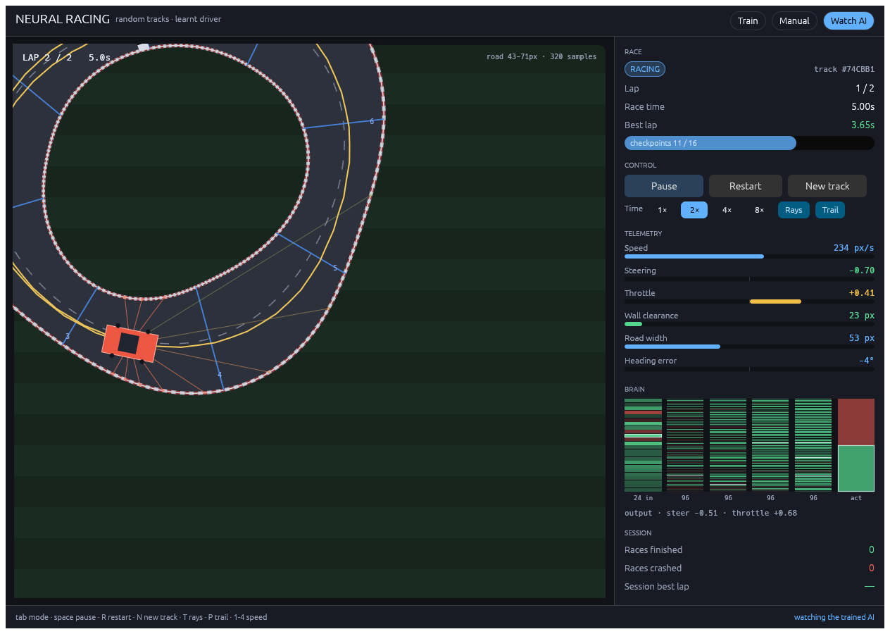
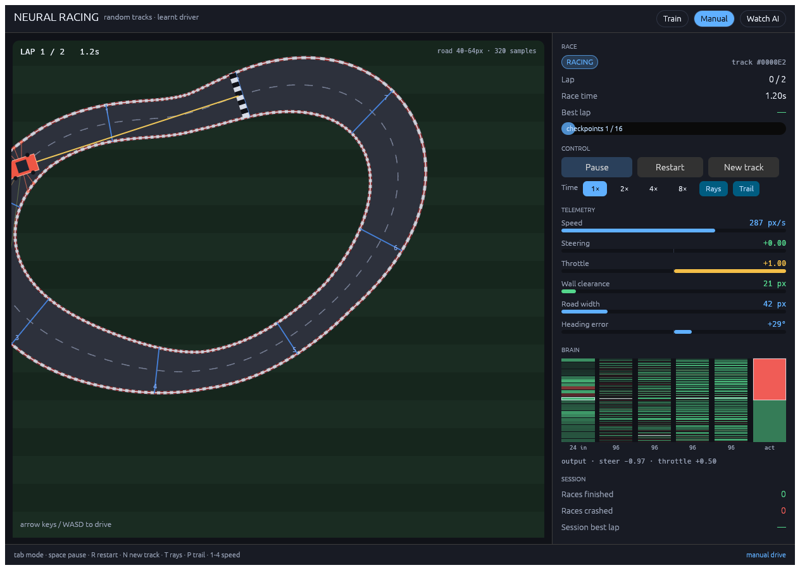
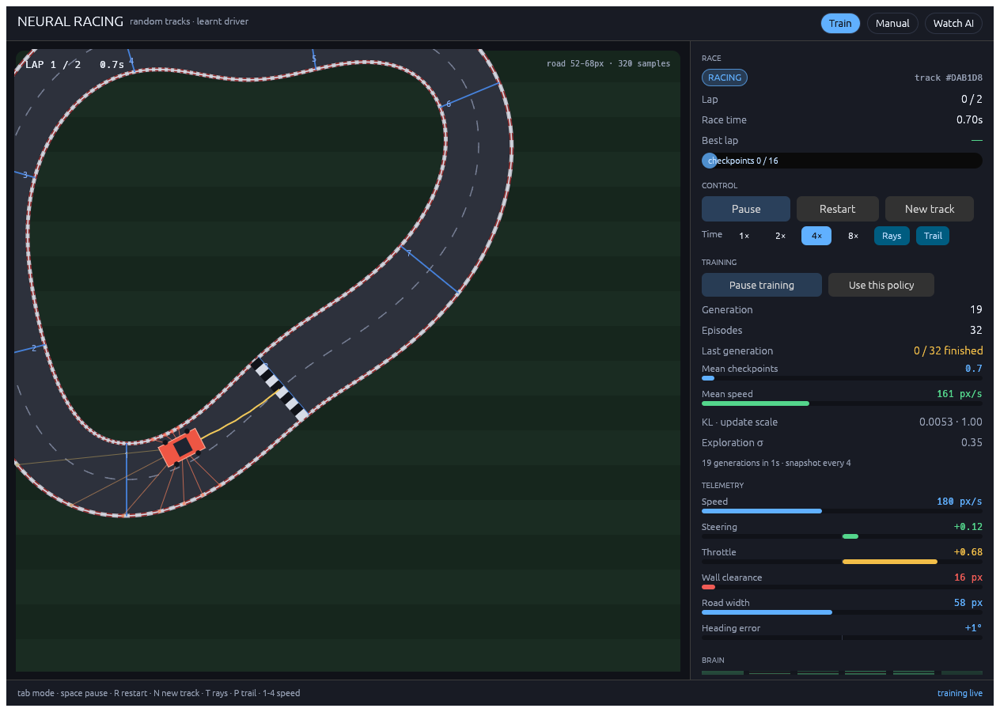

# Neural Racing

A top-down racing game in Rust with a neural driver that learns the track — except
there is no fixed track. Every race draws a new one: a closed loop of random lobes,
randomly stretched and rotated, with a road that pinches and widens around the lap.
The car is a bicycle-model racer with noisy steering servo, weight transfer, and
eleven distance sensors; the driver is a residual MLP trained with policy gradients
on random tracks only.

The project is pure Rust: one binary for the game, one for training, one for
verification. No Python, no libtorch, no vendored framework.

## Play

```sh
cargo run --release -p neural_racing_gui
```

| Key | Action |
| --- | --- |
| `Tab` | cycle Watch AI → Manual → Train |
| `Space` | pause / resume |
| `R` | restart on the same track |
| `N` | new random track |
| `T` / `P` | toggle sensor rays / skid trail |
| `1`–`4` | simulation speed (1×, 2×, 4×, 8×) |
| Arrows / `WASD` | drive in Manual mode |

Launch flags: `--mode watch|manual|train`, `--seed N` (track), `--speed X`,
`--policy PATH` (defaults to `models/policy.bin`).

The right-hand dashboard shows the race clock, lap and checkpoint progress, live
telemetry (speed, steer, throttle, wall clearance, heading error), and the network's
own activations — input sensors, every residual layer, and the two outputs — so you
can see *why* the car turned. In Train mode the same window becomes a training
console: generations per second, KL, exploration σ, finish/crash/timeout counts and
a snapshot of the policy that the hero car is currently driving.



## Train

The shipped policy came from one base run and two short robustness passes, all
seeded and deterministic:

```sh
# 1. base run — learns to drive, 100% of its evaluation tracks by the end
train --generations 2600 --episodes-per-worker 3 --eval-every 50 --eval-tracks 192 \
      --seed 90210 --out models/policy.bin

# 2. robustness pass — selection against 1000 tracks instead of 192
train --generations 900 --resume models/best.bin --out models/policy.bin \
      --episodes-per-worker 3 --eval-every 30 --eval-tracks 1000 --seed 90210

# 3. final pass — with SPEED_EXCESS_PENALTY = 1.2 (the value in the source);
#    stages 1-2 ran with 0.45. Trades ~12% mean speed for margin.
train --generations 250 --resume models/best.bin --out models/policy.bin \
      --episodes-per-worker 3 --eval-every 50 --eval-tracks 2000 --seed 90210
```

(`--workers` is the core count; every stage above ran with 17.) The base stage takes
about sixteen minutes on 17 cores, the two passes roughly twelve minutes together.
Stage 2 is what fixed the last stubborn crashes: `models/best.bin` is chosen by
finishes over 1000 tracks, so selection pressure matches the acceptance criterion
instead of 192 samples.

Each generation races one car per worker on its own freshly generated track, with
independent exploration noise on the two actions. Gradients from all rollouts are
summed into one shared policy; a step is only accepted if its measured policy KL
stays under the limit, otherwise Adam backtracks. The best checkpoint (most
logged finishes, then distance) is written next to the final one, and training stops
early once every evaluation track finishes.

## Verify

```sh
cargo run --release -p neural_racing_engine --bin verify -- \
    --model models/policy.bin --tracks 100 --seed 9000000
```

`verify` draws tracks from seeds the trainer never saw and exits non-zero unless
every one of them completes two laps without leaving the road. The shipped policy
finished **15000/15000** tracks, drawn as 1000-track batches from the fifteen seed
bases between `20000000` and `210000000`, none of which overlap the training or
evaluation seeds. Zero crashes, zero timeouts, mean speed 237 px/s.

That sweep was also the selection set when the shipped snapshot was chosen, so it is
optimistic by construction. A blinded confirmation on five bases no earlier run had
touched (`230000000`–`270000000`) finished **5000/5000** with zero crashes and zero
timeouts.

## How the tracks are generated

`Track::random(seed)` is deterministic. The centerline is star-shaped in polar
form — a base radius plus two to four harmonics (orders 2–7) with random amplitude
and phase — so the loop can never cross itself. It is stretched, rotated, and
offset inside the arena, then rejected and redrawn if any invariant fails:

- lap length stays between 700 and 1700 world units (small tracks, not arena-sized
  ovals),
- corners keep at least 1.7 road half-widths of radius and at least 74 units of
  turn radius, so the inner wall never folds and the car's own turning circle can
  follow the line,
- sections more than 22% of a lap apart keep their walls at least 0.4 half-widths
  apart, so the loop never pinches shut,
- both walls stay inside the arena.

Road width is a second harmonic profile: a random nominal half width of 22–32 units
modulated by one or two more harmonics, clamped to 0.66–1.45× the nominal, giving
41–93 unit roads that pinch in corners and open on sweepers. Walls are offset per
sample, so the road, kerbs, checkpoint gates, ray casting and the off-track test all
use the local width rather than a constant. A car that drifts more than the local
half width from the centerline is off the road.

Sensors are eleven rays in a ±140° fan, square-root compressed so a 40-unit-wide
road is not quantized into the bottom percent of the input. The observation vector
is eight state features (speed, slip, yaw rate, steer, lateral offset as a fraction
of the local width, heading error sin/cos, speed fraction) and five road-preview
features (lateral offset and width 55 and 110 units ahead, the heading change over
the next 90 units, and the speed demand of the tightest corner within 260 units —
the speed that corner allows divided by the current speed). The eleven compressed
ray distances follow.

The speed-demand term is what makes the AI brake: without it the network only saw
corners roughly a quarter second ahead and drove flat out into the tight ones.

Training mixes three kinds of track per worker round: an ordinary random track, a
narrow one, and a hard one (narrow and sharp), so the tail the evaluation set only
occasionally samples is practised directly.

## Rewards

Per step: progress along the track tangent (`distance / 60`), minus time and slip
cost. Progress is paid every step so standing still is never competitive. Each gate
pays `+1.5`, and each completed lap pays `+12` plus a pace bonus for beating the
reference lap time.

Three costs shape the driving:

| Term | Size | Why |
| --- | --- | --- |
| Wall closeness | up to `-0.5`, squared | skimming the wall is not free |
| Excess speed | `-1.2 × (speed / corner limit - 1)`, clamped | the tightest corner within 260 units defines a limit speed; running above it costs every step |
| Off track | `-20`, race over | strong enough to dominate the progress banked on the run-up |

The excess-speed term was the missing piece: with only the terminal penalty, the
extra progress from arriving at a corner flat out roughly paid for the crash, so the
policy simply never braked. Returns use `GAMMA = 0.995`, so the policy sees roughly
ten seconds ahead — longer than one lap on these tracks.

## Crates

| Crate | Role |
| --- | --- |
| `neural_racing_core` | Seeded track generation, bicycle physics, sensors, checkpoints, rewards |
| `neural_racing_ml` | Residual MLP with hand-written forward/backward pass, Adam, KL-limited update, binary weights |
| `neural_racing_engine` | Parallel rollouts, generation loop, evaluation, `train` and `verify` binaries |
| `neural_racing_gui` | egui/eframe game window: race view, dashboard, live training |

## Tests

```sh
cargo test --workspace
```

- `crates/neural_racing_core/tests/random_tracks.rs` — every seed builds a drivable,
  arena-sized loop with varying width; gates respect the local width; observations
  are normalized; the env is deterministic per seed.
- `crates/neural_racing_core/tests/two_lap_race.rs` — a curvature-braking pursuit
  driver completes two laps on 40 random tracks, proving the geometry is physically
  solvable without the learned policy; a crawl times out; a finished race is
  terminal.
- `crates/neural_racing_ml/tests/training.rs` — policy round-trip, KL rollback,
  action clipping, and a learning smoke test.
- `crates/neural_racing_gui/tests/screenshots.rs` — renders the real UI headlessly
  through `egui_kittest` + wgpu (no window opens) and writes
  `docs/screenshots/*.png`; also asserts the AI still drives, arrow keys move the
  car in Manual mode, and live training streams generations into the dashboard.

## Screenshots

| Watch | Manual | Train |
| --- | --- | --- |
|  |  |  |

All three are rendered by `crates/neural_racing_gui/tests/screenshots.rs` through the
real UI code, so they cannot drift from the app. `docs/screenshots/before-python.png`
is the pygame version this replaced, kept for comparison.
