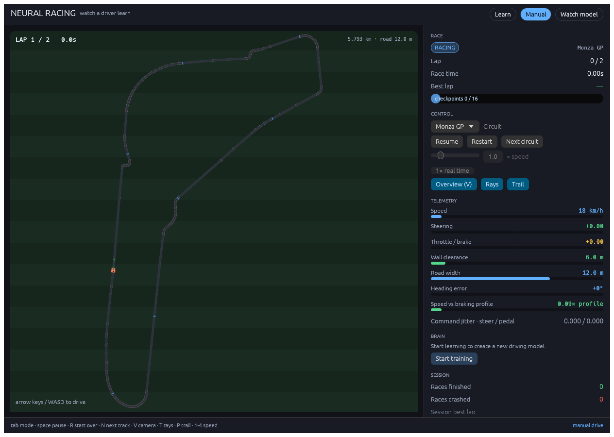
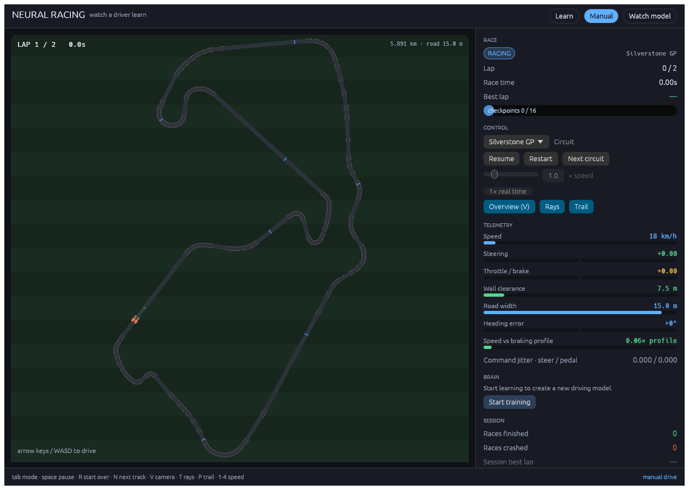
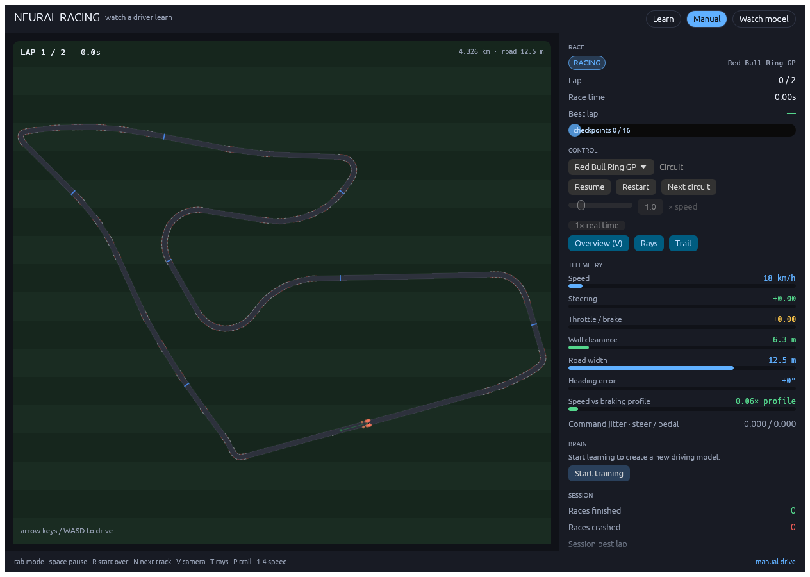
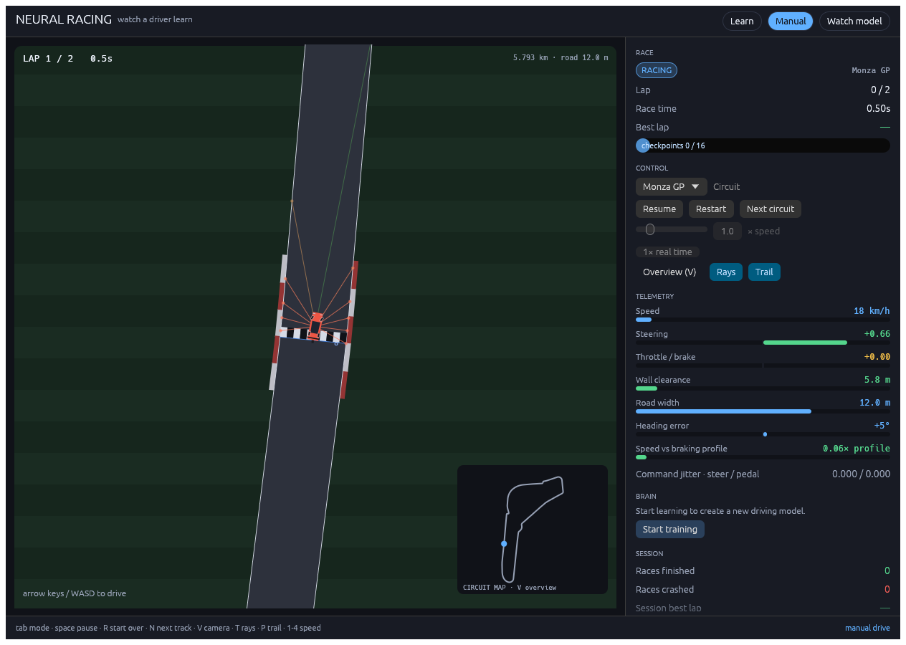

# Neural Racing

A top-down racing game in Rust with three real Grand Prix circuits: **Monza
(5.793 km), Silverstone (5.891 km), and the Red Bull Ring (4.326 km)**. The car
uses the BMW M4 GT3's 5.020 × 2.040 m footprint and 2.917 m wheelbase as its scale
reference. A follow camera keeps the car visible; press **V** for the whole layout.
The circuit menu also offers the original seeded procedural training courses.

The car uses four-wheel vehicle physics with tire grip, weight transfer and eleven
distance sensors. The app opens into **live learning from scratch**: four cars
share one residual MLP and learn from the attempts you see on the selected circuit.

The application is written in Rust. On macOS, dense model updates use the system
Accelerate framework; other platforms use the portable Rust implementation.
There is no Python runtime, libtorch, or extra framework installation.

## Play

```sh
cargo run --release -p neural_racing_gui
```

| Key | Action |
| --- | --- |
| `Tab` | cycle Learn → Watch model → Manual |
| `Space` | pause / resume |
| `R` | Start over (fresh model in Learn); restart the race in other modes |
| `N` | next real circuit / new procedural track |
| `V` | toggle follow camera / circuit overview |
| `T` / `P` | toggle sensor rays / skid trail |
| Slider | learning speed, logarithmic **0.25×–2000×**; **Max** runs uncapped; 1× restores real time |
| `1`–`4` | speed shortcuts (1×, 2×, 4×, 8×) |
| Arrows / `WASD` | drive in Manual mode |

The default is Learn on Monza at 1×. The speed slider controls physics and learning
throughput together. All four cars remain live at every speed; rendering consumes
the newest actual training states without a replay queue. At high speed many fixed
physics steps happen between display frames. The **achieved speed** readout reports
per-car simulated time divided by wall time, including model-update overhead.
It automatically falls below the requested setting when the computer cannot keep up.

Choose which car to follow, or press **V** for the overview. Ghosts and the minimap
show the other three cars. Practice starts are distributed around the selected circuit so the model meets
different corners sooner. Each attempt targets **five consecutive laps**. An attempt
ends after the fifth lap, leaving the road,
timeout, or ten simulated seconds without five metres of forward progress. The
car restarts and learning continues until paused or the app closes.

**Pause** stops driving and model updates while preserving the in-memory session.
**Start over** creates fresh weights and clears the session's statistics. Changing
circuits preserves the weights and optimizer, starts new attempts, and keeps each
circuit's progress history separate. The dashboard shows attempts, completed laps,
best lap, completed five-lap goals, best consecutive-lap streak, model updates and
the fraction of the five-lap goal reached on recent attempts. Learning can
regress as the policy explores; the graph shows actual attempts, not a smoothed
claim of continuous improvement. There is **no save/load control or automatic
checkpointing** in live learning. Closing the app discards that session.

Manual driving is a secondary mode. Watch model lets you inspect the current
session's policy without exploration noise; switching out of Learn pauses training.

Launch flags: `--mode train|manual|watch`, `--speed X|max` (numeric range 0.25–2000),
`--track monza|silverstone|red-bull-ring|random`, and `--seed N` for a legacy
procedural course. Explicit watch mode can still inspect the project's shipped
policy with `--policy PATH`; fresh learning never loads it.


## Live learning implementation and performance

The four visible cars supply every training sample from the same policy version,
each with an independent normal draw. The brain is a **normalized residual
actor-critic with 350,725 parameters**: a 67-input observation (56 hand-set
features plus 11 rays), five 256-unit residual blocks with layer normalization,
and three heads for steer, throttle/brake and state value. Exploration sigma is
learned per state and squashed into `[0.15, 0.6]`, so it cannot collapse to a
noise-free policy or explode into random driving. The estimator is PPO with
GAE(`γ = 0.999`, `λ = 0.95`), advantage normalization, a clipped surrogate, an
entropy bonus, three epochs over minibatches of 256 and gradient clipping at
1.0. An update stops before a minibatch if the measured policy KL exceeds 0.02,
and reverts the entire update to its starting parameters and Adam moments if any
step pushes KL above 0.05. Updates collect completed attempts from all four cars,
with a ceiling of 4096 decisions per car and 300,000 rows globally, and wait for
at least 1024 rows before stepping the optimizer so that a degenerate policy
dying in a few dozen steps cannot shrink a batch into noise; a trajectory
cut at either ceiling is bootstrapped with the current value, while a terminal
attempt is not. An attempt that makes less than five metres of progress in 200
decisions is ended with a `-40` stall penalty, which is worse than crashing:
parking in front of a corner must never be the return-maximising move. Every 200
updates a deterministic 1200-decision audit records the best mean policy; if that
policy later stalls or falls below 40% of its best progress, the parameters and a
fresh Adam state are restored and the cars restart, so a late collapse cannot
leave the lesson parked. Switching tracks discards unfinished samples without
mixing old observations with a new policy. There is no independent demonstration
car.

A single background coordinator advances all four cars using batched inference;
rendering runs separately. Physics stays at 120 Hz with 20 control decisions per
simulated second, independent of speed. Work is divided into short slices and the
UI receives fresh states roughly every 16 ms. Missed wall-clock time is capped,
so resuming or waking the computer cannot trigger an unlimited catch-up burst.
Spatial lookups accelerate sensor queries without changing exact intersections.

Run the reproducible, in-memory benchmarks (no weights saved):

```sh
cargo run --release -p neural_racing_engine --example live_benchmark -- 15 42 monza
cargo test --release -p neural_racing_gui --test screenshots sustained_live_render_at_max_speed -- --ignored --nocapture
```

The first measures learning throughput; the second renders the actual UI throughout
30 seconds on each circuit and reports achieved speed, state refresh frequency and
95th-percentile rendering time. See [validation results](docs/learning-validation.md)
for the measured hardware and results. The numeric slider is a pacing target;
**Max** removes pacing and uses the available simulation throughput. Live cars,
fixed physics, learning and responsive controls remain active. Moving the slider
or pressing 1× leaves Max mode. The worker no longer sleeps between work slices
when it has queued work. See [capacity measurements](docs/speed-capacity.md) for
this computer's measured limit and the distinction from a theoretical hardware limit.

## Real circuit scale and references

The [reference vault](docs/reference/README.md) contains source screenshots, circuit
maps, on-track car photographs, provenance, and a browsable [image gallery](docs/reference/index.html).
Geographic centerlines are projected without stretching either axis, lightly rounded
(with local smoothing before length normalization), and scaled to published lap
lengths. Nominal road widths are 12 m at Monza, 15 m at Silverstone, and 12.5 m at
the Red Bull Ring; these are representative widths, not surveyed width profiles.
Elevation, cambers, pit lanes and exact kerb placement are not modeled. The driving
dynamics use a planar GT-style vehicle model with representative parameters;
this is not a manufacturer-calibrated GT3 simulator.

An independent rear-axle pursuit driver is tested for five complete laps on all
three circuits. Practice-start tests also verify a full circuit is required. The race budget scales with physical length. Speeds
and widths are shown in km/h and metres. Live learning uses the selected real circuit;
the separate legacy headless trainer continues to use procedural courses.

| Monza | Silverstone | Red Bull Ring |
| --- | --- | --- |
|  |  |  |

## Vehicle handling

The body follows a planar four-contact-patch model referenced at its centre of mass.
At low speed the rear axle rolls without lateral sliding. At higher speed, front
and rear tire forces act at each wheel position, using that wheel's Ackermann
angle, local velocity and normal load to produce force and yaw moment. The visible front wheels use Ackermann angles (the inside wheel turns
farther); rear wheels remain aligned with the chassis.

Representative parameters: 1450 kg mass, 2300 kg·m² yaw inertia, 2.917 m wheelbase,
1.35 tire friction coefficient, 390 kW wheel power and a 288 km/h speed ceiling.
The model includes speed-limited engine force, aerodynamic drag/downforce,
longitudinal and lateral load transfer, load-sensitive grip, transient tire-force
buildup over a 0.45 m relaxation length, and a friction circle shared between
braking/acceleration and cornering at each wheel. A filtered steering target feeds
a damped rack actuator with rate and acceleration limits; pedal response is
smoothed. The trail records actual positions at 120 Hz. Holding the brake stops the car without engaging reverse.
At viewing speeds up to 4×, display poses interpolate between control steps;
accelerated learning continues to show current actual states.

The vehicle's mass, grip and aerodynamic coefficients are representative tuning
values, not BMW telemetry. Suspension motion, tire temperature, track elevation
and gearbox simulation remain outside this planar model. The standard model's
centre-of-mass and low-speed relationships are described in the
[CommonRoad vehicle dynamics reference](https://gitlab.lrz.de/tum-cps/commonroad-vehicle-models/-/blob/master/MATLAB/vehiclemodels/vehicleDynamics_ST.m).



## Legacy headless training

**Historical archive:** the runs and shipped weights below used the previous
arcade dynamics. They do not validate the new handling. The current observation
includes steering rate and applied pedal position; old weights are rejected.
Start training from scratch with the current code. Live learning does not read or
write those files.

The shipped policy came from one base run and two short robustness passes, all
seeded and deterministic:

```sh
# 1. base run — learns to drive, 100% of its evaluation tracks by the end
train --generations 2600 --episodes-per-worker 3 --eval-every 50 --eval-tracks 192 \
      --seed 90210 --out models/policy.bin

# 2. robustness pass — selection against 1000 tracks instead of 192
train --generations 900 --resume models/best.bin --out models/policy.bin \
      --episodes-per-worker 3 --eval-every 30 --eval-tracks 1000 --seed 90210

# 3. final pass — with SPEED_EXCESS_PENALTY = 1.2 (the value in the source);
#    stages 1-2 ran with 0.45. Trades ~12% mean speed for margin.
train --generations 250 --resume models/best.bin --out models/policy.bin \
      --episodes-per-worker 3 --eval-every 50 --eval-tracks 2000 --seed 90210
```

(`--workers` is the core count; every stage above ran with 17.) The base stage takes
about sixteen minutes on 17 cores, the two passes roughly twelve minutes together.
Stage 2 is what fixed the last stubborn crashes: `models/best.bin` is chosen by
finishes over 1000 tracks, so selection pressure matches the acceptance criterion
instead of 192 samples.

Each generation races one car per worker on its own freshly generated track, with
independent exploration noise on the two actions. Gradients from all rollouts are
summed into one shared policy; a step is only accepted if its measured policy KL
stays under the limit, otherwise Adam backtracks. The best checkpoint (most
logged finishes, then distance) is written next to the final one, and training stops
early once every evaluation track finishes.

## Historical verification of the shipped policy

These figures apply to the old physics and weights only. For the current vehicle,
use `cargo test --workspace` and the live benchmark above.

```sh
cargo run --release -p neural_racing_engine --bin verify -- \
    --model models/policy.bin --tracks 100 --seed 9000000
```

`verify` draws tracks from seeds the trainer never saw and exits non-zero unless
every one of them completes two laps without leaving the road. The shipped policy
finished **15000/15000** tracks, drawn as 1000-track batches from the fifteen seed
bases between `20000000` and `210000000`, none of which overlap the training or
evaluation seeds. Zero crashes, zero timeouts, mean speed 237 px/s.

That sweep was also the selection set when the shipped snapshot was chosen, so it is
optimistic by construction. A blinded confirmation on five bases no earlier run had
touched (`230000000`–`270000000`) finished **5000/5000** with zero crashes and zero
timeouts.

## How the procedural training tracks are generated

`Track::random(seed)` is deterministic. The centerline is star-shaped in polar
form — a base radius plus two to four harmonics (orders 2–7) with random amplitude
and phase — so the loop can never cross itself. It is stretched, rotated, and
offset inside the arena, then rejected and redrawn if any invariant fails:

- lap length stays between 700 and 1700 world units (small tracks, not arena-sized
  ovals),
- corners keep at least 1.7 road half-widths of radius and at least 74 units of
  turn radius, so the inner wall never folds and the car's own turning circle can
  follow the line,
- sections more than 22% of a lap apart keep their walls at least 0.4 half-widths
  apart, so the loop never pinches shut,
- both walls stay inside the arena.

Road width is a second harmonic profile: a random nominal half width of 22–32 units
modulated by one or two more harmonics, clamped to 0.66–1.45× the nominal, giving
41–93 unit roads that pinch in corners and open on sweepers. Walls are offset per
sample, so the road, kerbs, checkpoint gates, ray casting and the off-track test all
use the local width rather than a constant. A car that drifts more than the local
half width from the centerline is off the road.

Sensors are eleven rays in a ±108° fan with a 70 m range, square-root
compressed to preserve resolution near road edges. The 67-value observation has
56 state and road-preview features followed by the eleven ray distances. It
includes speed, slip, yaw rate, steering angle and rate, applied pedal, lateral
position, heading alignment, road previews at 12 m and 35 m, heading change over
20 m, and how tight the next 60 m is. Additional inputs expose previous commands,
their first and second differences, steering target, longitudinal/lateral and yaw
acceleration, front/rear grip usage and loads, lap progress, braking distance,
signed road headings at 10, 25, 50, 100 and 200 m, the braking-distance speed
profile now and at 100 m and 300 m with the current margin, road-frame lateral
velocity, tyre lateral force per axle, command deltas, lateral demand and grip
reserve.

Training mixes three kinds of track per worker round: an ordinary random track, a
narrow one, and a hard one (narrow and sharp), so the tail the evaluation set only
occasionally samples is practised directly.

## Rewards

Per decision: `0.1` per metre advanced along the track tangent, minus a time cost
(`-0.01`, growing to `-0.06` at standstill), a small slip cost, smoothness terms on
the first and second command differences, and a stability term above six degrees
of slip. The dense costs reward controlled driving without requiring a centreline
path through every corner; they do not scale with lap number. The two speed
terms form a target: pay for staying under the safe profile, pay more for
exceeding it.

| Term | Size | Why |
| --- | --- | --- |
| Wall closeness | up to `-0.35`, squared, when the nearest ray is inside 85% of the half width | skimming the wall is not free |
| Excess speed | `-0.25 × (speed / profile - 1)` above the profile, clamped to two | a cyclic braking-distance profile, not the tightest corner 300 m away, defines the limit |
| Speed shortfall | up to `-0.10` below the profile, fading to zero at it | unused grip is as wasteful as overspeed; without it a policy that never survives the first corner learns to park the throttle |
| Off track | `-30` in the step reward, race over | dominates the progress banked on the run-up |
| Timeout | `-40`, race over | exhausting the step budget must be worse than crashing, otherwise parking in front of a corner is return-maximising |
| Stall | `-40` after 200 decisions with under five metres of progress | trims hopeless live attempts without rewarding them |

Checkpoints and laps pay only once per forward milestone, so reverse crossings
cannot farm rewards. Each gate pays `+2`, each completed lap `+20`, and each
consecutive lap an extra `+3` per lap. A five-lap stint earns a further `+30` and
a pace bonus of up to `+15` for finishing ahead of the reference time.

Progress pays `0.1` per metre advanced along the track, so a Monza lap is worth
roughly 580 points before gate and lap bonuses; the small oval used by the unit
tests is worth about 16. The speed profile is built once per track by clamping
every sample to its curvature limit and propagating the braking limit backwards
twice around the loop; a straight therefore never charges the policy for full
throttle. Returns use `GAMMA = 0.999` at 20 Hz and `GAE_LAMBDA = 0.95`, an
effective credit horizon of about twenty decisions (one second), so a braking
zone is credited back to its entry rather than being judged only at the corner.

## Crates

| Crate | Role |
| --- | --- |
| `neural_racing_core` | Real and procedural tracks, four-wheel physics, sensors, checkpoints, rewards |
| `neural_racing_ml` | Normalized residual actor-critic with hand-written forward/backward pass, Adam, PPO update, binary weights |
| `neural_racing_engine` | Parallel rollouts, generation loop, evaluation, `train` and `verify` binaries |
| `neural_racing_gui` | egui/eframe game window: race view, dashboard, live training |

## Tests

```sh
cargo test --workspace
```

- `crates/neural_racing_core/tests/random_tracks.rs` — every seed builds a drivable,
  arena-sized loop with varying width; gates respect the local width; observations
  are normalized; the env is deterministic per seed.
- `crates/neural_racing_core/tests/two_lap_race.rs` — a curvature-braking pursuit
  driver completes two laps on 40 random tracks, proving the geometry is physically
  solvable without the learned policy; a crawl times out; a finished race is
  terminal.
- `crates/neural_racing_ml/tests/training.rs` — policy round-trip, finite-difference
  gradients, trust-region bound, action clipping, and truncated-versus-terminal
  bootstrapping.
- `crates/neural_racing_gui/tests/screenshots.rs` — renders the real UI headlessly
  through `egui_kittest` + wgpu (no window opens) and writes
  `docs/screenshots/*.png`; also asserts the AI still drives, arrow keys move the
  car in Manual mode, four actual training cars stay live at slow and fast speeds,
  and pause freezes both physics and learning. The optional sustained render
  benchmarks exercise all three real circuits at 1000× and uncapped Max.
- Engine live-session tests cover actual model updates, per-circuit history,
  five-lap attempts, individual lap timing, restart conditions and fixed-step scheduling. Sensor broad-phase
  tests compare against exhaustive geometry; matrix tests compare native products
  against scalar products and check gradients.

## Screenshots

| Watch | Manual | Train |
| --- | --- | --- |
|  |  |  |

All three are rendered by `crates/neural_racing_gui/tests/screenshots.rs` through the
real UI code, so they cannot drift from the app. `docs/screenshots/before-python.png`
is the pygame version this replaced, kept for comparison.
